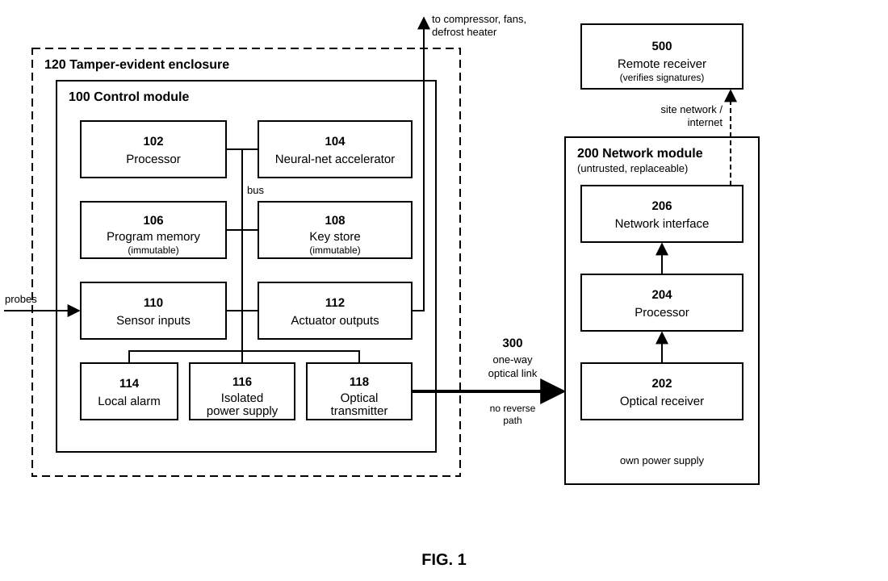

# Defensive Publication: Network-Isolated Autonomous Controller with Unidirectional Data Egress

**First published:** 14 November 2026  
**Author:** Ian Beard — [cedairn open design](https://cedairn.com)  
**Licence:** [Creative Commons Attribution 4.0 International (CC BY 4.0)](https://creativecommons.org/licenses/by/4.0/)

## Purpose

This is a **defensive publication**. It is published openly as prior art, to put the system it
describes, and every variation it lists, into the public record so that no one can patent them.
The author makes no patent claim. Anyone is free to build, use, modify and sell systems based
on this disclosure.

## Abstract

A control system for equipment such as a supermarket freezer has a sealed control module and a
separate network module, joined only by a one-way optical link. The control module runs
autonomously, optionally with an on-chip neural-network accelerator, from program memory made
permanently unmodifiable, and it contains no network interface, radio or data receiver. It signs
each operating-data record with a key fixed at manufacture and gives it a sequence number, then
transmits the record repeatedly over the optical link. The untrusted network module, or a mobile
courier such as a robot reading an optical port, forwards the records to a remote receiver. The
receiver verifies signatures and detects missing or overdue records. Separate power supplies
prevent any electrical reverse path. Compromising any downstream component can stop delivery,
which is detected, but cannot change control behaviour or forge data.

## Contents

| File | Description |
|---|---|
| [`Defensive-Publication-Network-Isolated-Controller.pdf`](Defensive-Publication-Network-Isolated-Controller.pdf) | The publication (authoritative version, 10 pages, A4) |
| [`Defensive-Publication-Network-Isolated-Controller.docx`](Defensive-Publication-Network-Isolated-Controller.docx) | Editable source |
| [`figures/`](figures/) | FIG. 1–4 as SVG and PNG |
| [`SHA256SUMS`](SHA256SUMS) | SHA-256 hashes of the published files |

### Figures

- **FIG. 1** — System block diagram: control module 100, network module 200, unidirectional optical link 300, remote receiver 500
- **FIG. 2** — Operating-data record format 400
- **FIG. 3** — Courier embodiment: mobile robot 600 reading optical port 130
- **FIG. 4** — Record verification flow at the remote receiver 500

## Citing

Beard, I. (2026). *Defensive Publication: Network-Isolated Autonomous Controller with
Unidirectional Data Egress.* cedairn open design. First published 14 November 2026.
https://github.com/cedairn/defensive-publication-network-isolated-controller

## Licence

Text and figures © 2026 Ian Beard, released under
[CC BY 4.0](https://creativecommons.org/licenses/by/4.0/). See [`LICENSE`](LICENSE).
